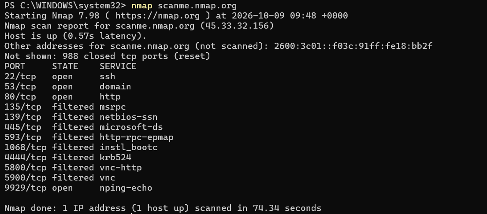
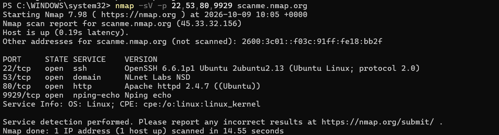
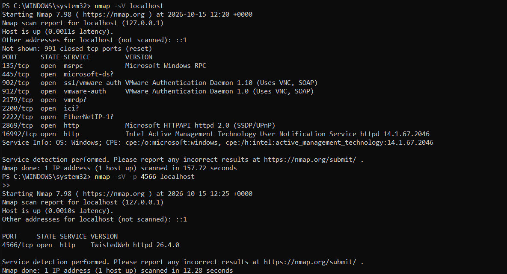
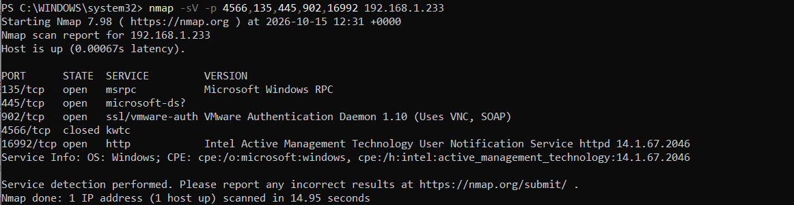
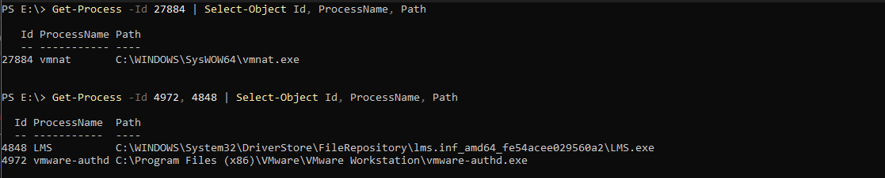
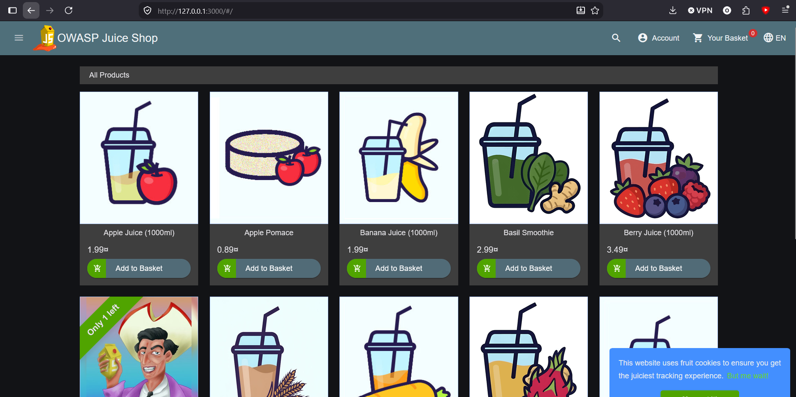
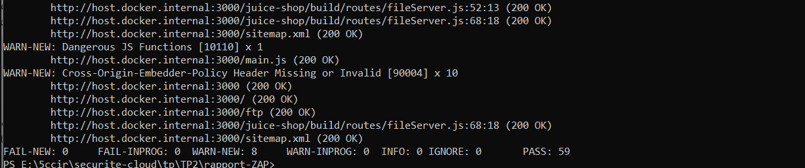
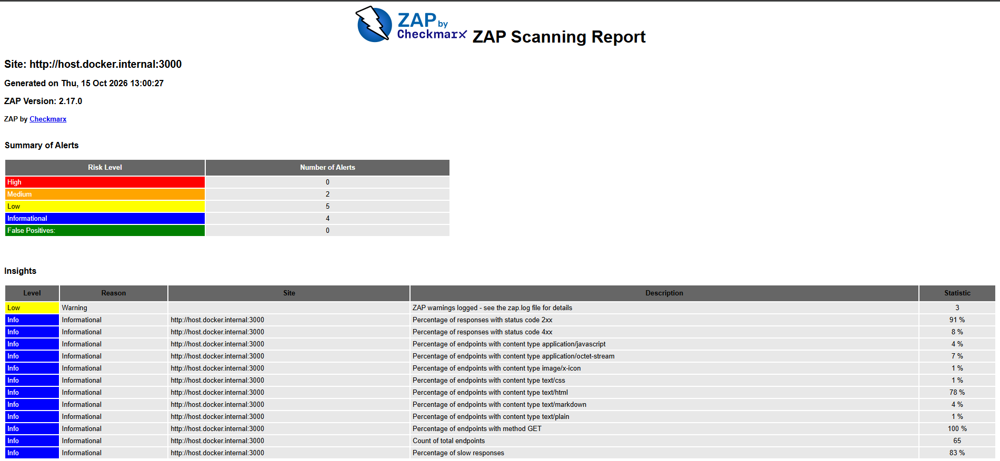
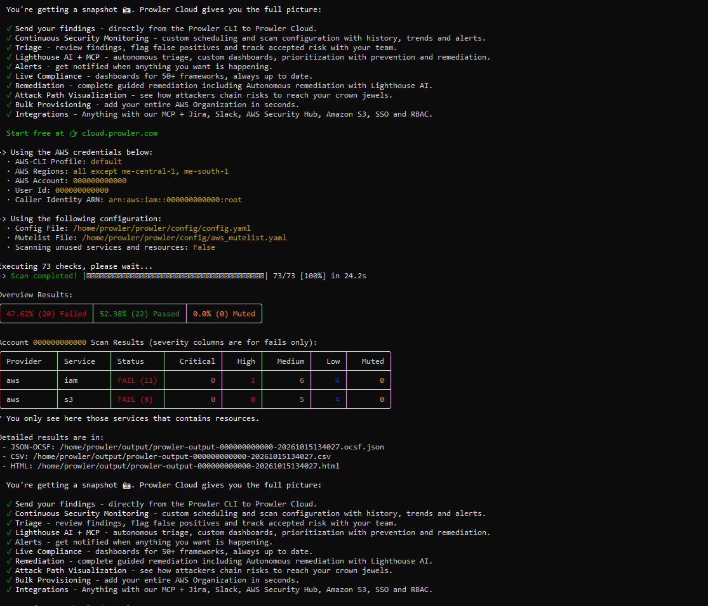
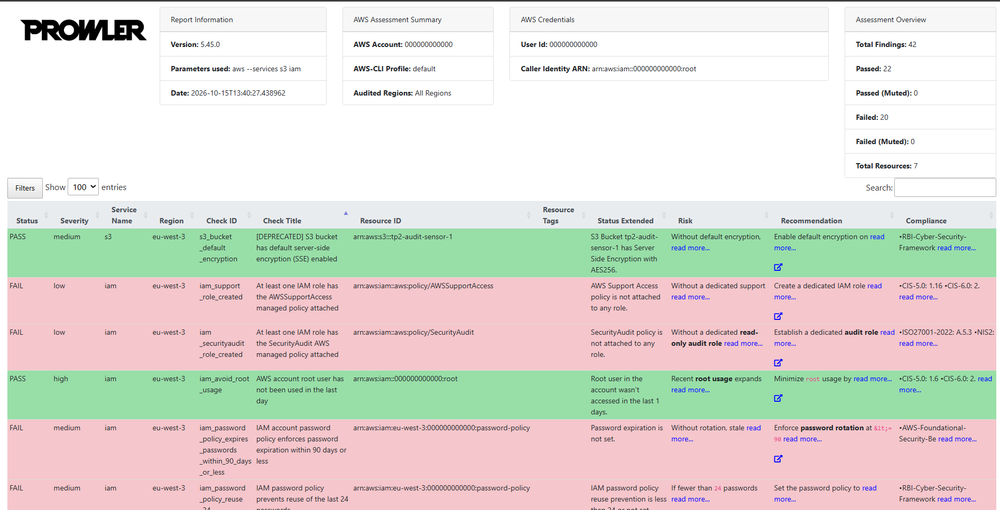

# Audit d'exposition et de posture cloud

**Nmap · OWASP ZAP · Prowler (CSPM) · LocalStack · Docker**

Cartographier une surface d'attaque, auditer une application web vulnérable et évaluer la posture de sécurité d'un environnement AWS émulé, puis transformer chaque résultat en décision : ce qu'un **analyste SOC** surveillerait, ce qu'un **architecte sécurité** corrigerait.

## En bref

| | |
|---|---|
| **Objectif** | Identifier, qualifier et prioriser les expositions d'un système, de la couche réseau à la configuration cloud |
| **Cibles (toutes autorisées)** | `scanme.nmap.org` (serveur public de test mis à disposition par les auteurs de Nmap), OWASP Juice Shop (conteneur local), AWS émulé par LocalStack (local) |
| **Outils** | Nmap, OWASP ZAP 2.17.0, Prowler 5.45.0, AWS CLI v2, Docker, PowerShell |
| **Approche** | Reconnaissance, analyse de risque par port, scan applicatif passif, audit de posture cloud, comparaison avec un audit manuel |

### Résultats clés

- **Réseau :** 4 ports ouverts sur la cible publique (SSH, DNS, HTTP, service de test Nping) et des versions de services anciennes (OpenSSH 6.6.1p1, Apache 2.4.7 sur Ubuntu).
- **Poste hôte :** l'API LocalStack (4566) n'écoute que sur `127.0.0.1`, vérifié par scan, par `netstat` et par un test depuis l'interface LAN. Plusieurs services de gestion (RPC, SMB, VMware, Intel AMT) écoutent en revanche sur toutes les interfaces.
- **Application web :** 11 alertes ZAP (0 High, 2 Medium, 5 Low, 4 Info) : CSP absente, CORS trop permissif, fonction Angular qui contourne le filtrage XSS.
- **Posture cloud :** 42 résultats Prowler sur S3 et IAM en 24 s : 22 PASS, 20 FAIL (1 High, 11 Medium, 8 Low). Aucune exposition publique du bucket ; les écarts portent sur l'hygiène des identités, la résilience des données et la détection.
- **Enseignement :** un scanner mesure la conformité, pas le risque. Chaque résultat se qualifie avec son contexte : exposition réelle, sensibilité de la donnée, contrôles compensatoires.

## Périmètre et règles d'engagement

Les scans ne sont lancés que sur des cibles dont je suis propriétaire ou dont le scan est explicitement autorisé. Sur `scanme.nmap.org`, seul Nmap est utilisé, sans exploitation ni déni de service. Les identifiants AWS utilisés (`test`) sont fictifs et n'ont aucune valeur hors de l'émulateur. Les services de laboratoire (Juice Shop, LocalStack) sont publiés sur `127.0.0.1` uniquement.

## Architecture du laboratoire

```text
Poste hôte Windows (PowerShell, Nmap, AWS CLI)
│
├── Docker
│   ├── LocalStack            127.0.0.1:4566   AWS émulé (S3, IAM, STS)
│   ├── OWASP Juice Shop      127.0.0.1:3000   cible web volontairement vulnérable
│   ├── ZAP (éphémère)        ──► host.docker.internal:3000
│   └── Prowler (éphémère)    ──► host.docker.internal:4566
│
└── Cible publique autorisée : scanme.nmap.org
```

## Méthodologie et résultats

### 1. Reconnaissance réseau (Nmap)

```powershell
nmap scanme.nmap.org
nmap -sV -p 22,53,80,9929 scanme.nmap.org
```




| Port | Service détecté | Exposition justifiée ? | Mesure corrective |
|---|---|---|---|
| 22 | OpenSSH 6.6.1p1 (Ubuntu) | Non en général | Clés uniquement, filtrage par IP ou bastion |
| 53 | NSD (DNS autoritaire) | Oui, si serveur de noms | Pas de récursion ouverte (NSD est autoritaire uniquement) |
| 80 | Apache httpd 2.4.7 (Ubuntu) | Si site public | HTTPS, mise à niveau ou support étendu |
| 9929 | Nping echo | Non | Fermer le port |

**Lecture SOC et architecture**

- 988 ports répondent `closed (reset)` et 8 sont `filtered` : l'hôte répond directement, il n'applique pas de refus par défaut au niveau réseau. Un scan produit dans les logs un motif reconnaissable (une source, de nombreux ports, beaucoup de refus), détectable par une règle SIEM ou IDS.
- Une bannière de version n'est pas une preuve de vulnérabilité : sur Ubuntu, les correctifs sont rétroportés. La version sert à prioriser une vérification sur la machine, pas à conclure.

### 2. Exposition du poste hôte

```powershell
nmap -sV localhost
netstat -ano | findstr LISTENING
Get-Process -Id <PID> | Select-Object Id, ProcessName, Path
```





| Port | Service | Écoute | Qualification |
|---|---|---|---|
| 4566 | API LocalStack | `127.0.0.1` | Conforme : fermé depuis l'interface LAN |
| 135, 445 | RPC, SMB Windows | Toutes interfaces | À restreindre par le pare-feu hors réseau de confiance |
| 902 | VMware Authentication Daemon | Toutes interfaces | Limiter aux interfaces VMware |
| 2200, 2222 | Redirection NAT VMware (`vmnat.exe`) | Toutes interfaces | Supprimer ou limiter la règle |
| 16992 | Intel AMT (interface web) | Toutes interfaces | Désactiver si inutilisé, firmware à jour |

**Point d'architecte :** l'adresse de liaison est un contrôle de sécurité à part entière. Une API d'administration sans authentification n'écoute que sur la boucle locale. **Limite méthodologique :** scanner sa propre IP depuis le même poste ne traverse pas le pare-feu ; pour valider l'exposition réelle, il faut scanner depuis une autre machine.

### 3. Application web (OWASP ZAP, scan baseline passif)

```powershell
docker run -d --name juice-shop -p 127.0.0.1:3000:3000 bkimminich/juice-shop
docker run --rm -v ${PWD}:/zap/wrk:rw -t ghcr.io/zaproxy/zaproxy:stable zap-baseline.py `
  -t http://host.docker.internal:3000 -r rapport-zap.html
```





| Alerte | Risque | Catégorie | Lecture SOC | Lecture architecte |
|---|---|---|---|---|
| CSP Header Not Set | Medium | Mauvaise configuration | Perte d'un signal de détection XSS (rapports CSP) | Défense en profondeur, à déployer au niveau proxy ou WAF |
| Cross-Domain Misconfiguration (CORS) | Medium | API non sécurisée | Surveiller les `Origin` externes vers les API sensibles | Liste blanche d'origines, jamais de joker |
| Dangerous JS Functions (`bypassSecurityTrustHtml`) | Low | Faille applicative (XSS) | Chercher du HTML ou du JS dans les paramètres | Interdire par revue de code, règle SAST |

Les autres alertes concernent des en-têtes d'isolation absents (COEP, COOP), un en-tête déprécié (`Feature-Policy`), des horodatages exposés et des informations de cache.

**Limite :** un scan passif n'envoie aucune attaque. Zéro alerte High ne prouve pas l'absence de failles (injections, contrôle d'accès défaillant) ; ces classes demandent des tests actifs et une analyse humaine.

### 4. Posture cloud (Prowler, CSPM) et comparaison avec un audit manuel

L'audit manuel couvre trois contrôles : blocage d'accès public S3, chiffrement par défaut, MFA d'un utilisateur IAM.

```powershell
aws s3api get-public-access-block --bucket <bucket>
aws s3api get-bucket-encryption --bucket <bucket>
aws iam list-mfa-devices --user-name <utilisateur>
```

Prowler 5.45.0 est lancé par Docker (Python 3.14 n'est pas pris en charge par le paquet pip) et pointé vers l'émulateur par `AWS_ENDPOINT_URL` :

```powershell
docker run --rm -it -v ${PWD}:/home/prowler/output `
  -e AWS_ACCESS_KEY_ID=test -e AWS_SECRET_ACCESS_KEY=test -e AWS_DEFAULT_REGION=eu-west-3 `
  -e AWS_ENDPOINT_URL=http://host.docker.internal:4566 `
  prowlercloud/prowler:stable aws --services s3 iam
```





| Thème | PASS notables | FAIL |
|---|---|---|
| Exposition des données | Bucket non public, non listable, sans écriture publique, ACL désactivées, blocage d'accès public | Aucun |
| Identité | Pas de clé d'accès, pas de droit administrateur, pas de mot de passe console | Politique de mot de passe (7), MFA matériel (High), pas de SAML, rôles SecurityAudit et Support absents |
| Résilience des données | | Versioning, MFA Delete, Object Lock, réplication inter-régions, lifecycle |
| Détection | | Journalisation d'accès S3, notifications d'événements |
| Transport et chiffrement | Chiffrement par défaut AES256 | HTTPS non imposé, pas de chiffrement KMS |

| Critère | Audit manuel | Prowler |
|---|---|---|
| Contrôles couverts | 3 | 42 résultats sur 7 ressources |
| Effort | Quelques commandes | 1 commande, 24 s |
| Concordance | Blocage public OK, chiffrement OK, MFA absent | Mêmes conclusions, plus 17 écarts non recherchés |
| Contexte | Usage du bucket connu | Règles génériques, sans connaissance de l'usage |
| Apport | Précision, adaptation | Couverture, règles mises à jour, correspondance CIS, NIST, ISO 27001, PCI, NIS2 |

**Nuance utile :** le même constat (« pas de MFA ») donne un FAIL High pour le contrôle MFA matériel, mais un PASS pour le contrôle MFA d'accès console, car l'utilisateur n'a pas de mot de passe console. La sévérité d'un outil se relativise toujours avec le contexte.

## Plan de remédiation priorisé

| Priorité | Action | Justification |
|---|---|---|
| P1 | Supprimer les utilisateurs IAM locaux au profit de la fédération (SSO) ; MFA résistant au phishing pour tout accès humain | L'identité est le nouveau périmètre |
| P1 | Versioning, MFA Delete et Object Lock sur les données critiques | Rendre un incident récupérable (suppression, rançongiciel) |
| P1 | Journalisation d'accès S3 et événements de données | Sans journaux, une exfiltration ne laisse aucune trace |
| P2 | Politique HTTPS-only sur les buckets (`aws:SecureTransport`) | Empêcher l'interception |
| P2 | En-têtes CSP, COOP, COEP et CORS restrictif sur l'application | Défense en profondeur côté navigateur |
| P2 | Fermer ou restreindre les ports de gestion exposés (SMB, RPC, AMT, redirections NAT) | Réduire la surface d'attaque latérale |
| P3 | Chiffrement KMS, réplication, lifecycle, rôles d'audit et de support | Maturité et gouvernance |

```powershell
aws iam update-account-password-policy --minimum-password-length 14 --require-symbols --require-numbers --require-uppercase-characters --require-lowercase-characters --max-password-age 90 --password-reuse-prevention 24
aws s3api put-bucket-versioning --bucket <bucket> --versioning-configuration Status=Enabled
```

## Limites et enseignements

- L'environnement AWS est émulé : certains contrôles de niveau compte peuvent se comporter différemment d'un vrai compte. L'audit est mené avec l'identité root fictive de l'émulateur, ce qu'on ne ferait jamais en réel (rôle d'audit en lecture seule, type `SecurityAudit`).
- Un pourcentage de FAIL n'est pas un niveau de risque : le laboratoire est vide, et une grande partie des écarts sont des bonnes pratiques non appliquées.
- Le scan ZAP est passif. Il complète, sans les remplacer, des tests actifs et une revue de code.
- Une bannière de version doit être confrontée à l'inventaire et au niveau de correctif réel avant toute conclusion.

## Compétences démontrées

- Reconnaissance et analyse d'exposition : Nmap, détection de versions, lecture des états de ports, corrélation port, processus et propriétaire.
- Sécurité applicative : OWASP ZAP, lecture et priorisation des alertes, en-têtes de sécurité, CORS, XSS.
- Sécurité cloud : CSPM avec Prowler, IAM, S3, chiffrement, journalisation, correspondance avec les référentiels CIS, NIST, ISO 27001, NIS2.
- Conteneurs et réseau : Docker, publication de ports sur la boucle locale, réseau entre conteneurs et hôte.
- Posture d'architecte et de SOC : moindre privilège, défense en profondeur, qualification d'un résultat avant décision, plan de remédiation priorisé.
- Rigueur : cibles autorisées uniquement, secrets hors dépôt, limites méthodologiques documentées.

## Reproduire

```powershell
# 1. Environnement
docker run -d --name localstack -p 127.0.0.1:4566:4566 `
  -e LOCALSTACK_AUTH_TOKEN=$env:LOCALSTACK_AUTH_TOKEN `
  -v //var/run/docker.sock:/var/run/docker.sock localstack/localstack
$env:AWS_ACCESS_KEY_ID = 'test'
$env:AWS_SECRET_ACCESS_KEY = 'test'
$env:AWS_DEFAULT_REGION = 'eu-west-3'
$env:AWS_ENDPOINT_URL = 'http://localhost:4566'
aws s3 mb s3://audit-bucket-demo
aws iam create-user --user-name user-audit

# 2. Reconnaissance, ZAP puis Prowler : voir les commandes des sections ci-dessus

# 3. Nettoyage
docker stop juice-shop localstack
docker rm juice-shop localstack
```

Le jeton LocalStack se charge dans la session (`$env:LOCALSTACK_AUTH_TOKEN`) et n'est jamais écrit dans un fichier ni versionné.

## Structure du dépôt

```text
.
├── README.md
├── docs/images/   captures d'écran numérotées
└── reports/       rapports bruts (ZAP HTML, Prowler HTML et CSV)
```

## Autres projets

- [ARCHISOC-LAB-HOME](https://github.com/othmane71-art/ARCHISOC-LAB-HOME) : architecture SOC virtualisée (FortiGate, pfSense, Wazuh, honeypot Cowrie, WAF, DVWA)
- [Microsoft-Sentinel-SOC-Lab](https://github.com/othmane71-art/Microsoft-Sentinel-SOC-Lab) : SOC hybride avec Microsoft Sentinel et règles de détection KQL
- [forensic-artefacts-goad-mini-kali](https://github.com/othmane71-art/forensic-artefacts-goad-mini-kali) : investigation forensic live sur Windows Server AD et Kali Linux
- [tryhackme-soc-simulator-phishing-triage](https://github.com/othmane71-art/tryhackme-soc-simulator-phishing-triage) : triage d'alertes de phishing avec Splunk
